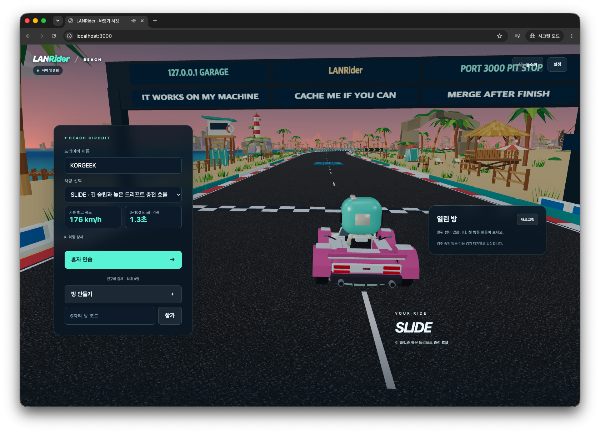
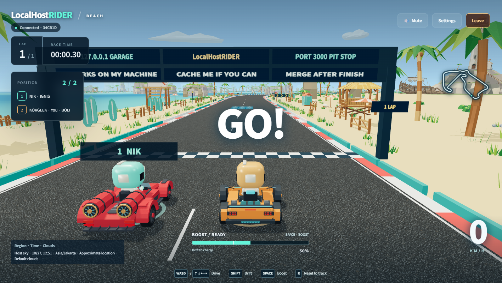
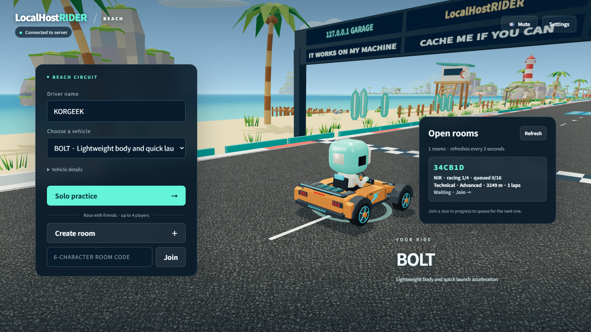

# LANRider

**Run locally. Race together.**

[한국어 README](README.ko.md)

LANRider is a self-hosted browser racing game intended for personal LAN parties. The software is MIT licensed; project artwork and music are licensed separately. You may use the project artwork and music under their respective terms and fork this repository on GitHub. Outside GitHub forks, you may not redistribute or sell those assets separately or as part of another product. See [asset terms](public/assets/licenses.md).

The project began as **LocalHostRIDER**, a name for running locally. It was renamed **LANRider** to reflect racing together on a LAN. Some screenshots retain the earlier name.

## Screenshots







## Quick start

### Run directly with Node.js

For a quick local try, install Node.js 24 and run these commands in the project directory. Docker is not required:

```sh
npm ci
npm start
```

Open [localhost:3000](http://localhost:3000) in a desktop browser to try the game. Stop the server with Ctrl+C. To run the automated tests, use `npm test` after stopping the server or in a separate terminal.

### Run with Docker

With Docker installed, run these commands in the project directory:

```sh
docker build -t lanrider .
docker run --rm --name lanrider -p 3000:3000 lanrider
```

Open [localhost:3000](http://localhost:3000) in a desktop browser. Stop the server with Ctrl+C.

For Docker on a shared LAN or behind a reverse proxy, advertise the address players can reach:

```sh
docker run --rm --name lanrider -p 3000:3000 -e "PUBLIC_ORIGIN=http://<server-lan-ip>:3000" lanrider
```

Replace the placeholder with your server address. `PUBLIC_ORIGIN` accepts an HTTP(S) origin, including its published port, and keeps invitation links from using a container's internal IP.

If your network blocks Docker Hub, choose a locally cached or organization-approved Node.js 24 image with `NODE_IMAGE`. For example, when this exact image is already available locally:

```sh
docker build --build-arg NODE_IMAGE=node:24.20.0-bookworm-slim -t lanrider .
```

This does not bypass network policy. An initial build still needs the three npm dependencies from an allowed registry or build cache; running the finished image does not download them.

### Connect over LAN

For friends on the same LAN, share `http://<server-lan-ip>:3000` and the room code or invitation link. `localhost` always means the machine opening the browser. Other players must use the server machine's reachable LAN address. If another PC cannot connect, first check whether the server PC’s OS firewall blocks Node.js or the TCP port in use (3000 by default) on the LAN. If needed, allow access only from a trusted network and follow your organization’s network policy. Network isolation or an incorrect server address can also prevent access.

## Play a short race

- Enter a driver name on your first visit, then choose one of eight vehicles and either practice alone or create a room on one of three circuits. Your saved name is used on later visits.
- Share the room code or invitation link. A room supports four racers plus sixteen spectators or waiting players.
- Ready up and let the host start. Choose 3/5/7 laps for Beach or 1/3/5 for Wave Coast and Crescent Bay when selecting the circuit. The first finish gives remaining racers up to ten seconds; results appear immediately when everyone finishes, including solo practice.
- If drivers are not ready, the host can confirm a forced start. Everyone gets five seconds to prepare, then the server readies the grid and begins the normal starting lights. The host leaving cancels this reservation.
- Watch a selected driver or follow the leader automatically. Waiting players enter later races in queue order.
- Change vehicles between races. When the host readies after a result, a ten-second rematch timer starts; if everyone is ready, it moves straight to the three-second start countdown. Withdrawing the host's readiness cancels automatic starting.

| Key | Action |
| --- | --- |
| W / ↑ | Accelerate |
| S / ↓ | Brake / reverse |
| A, D / ←, → | Steer |
| Shift | Drift and charge boost |
| Space | Boost when charged |
| R | Return to the track |
| F3 | Toggle driving / network / music diagnostics and collision boxes |

Press W / ↑ just as GO sounds to earn one free 0.9-second start boost. Holding forward early gives ordinary acceleration; release and time a fresh press to qualify.

The interface supports Korean and English. Settings include graphics quality and sound controls; browser storage remembers supported preferences.

## License and asset notices

Software is licensed under [MIT](LICENSE.md). Binary/project assets have separate terms; the software license does not automatically license every model, texture, or sound under MIT. See [Third-party notices](THIRD_PARTY_NOTICES.md) and [Asset provenance and licenses](public/assets/licenses.md) before redistributing assets.

## Internet hosting note

LANRider is built and tested for play among trusted people on a LAN. The checks recorded so far focus on local and Docker environments; connections across multiple physical PCs and Internet WAN play have not been verified. **Running a public Internet server is outside this project's support scope. Problems arising from public hosting will not receive follow-up support or maintenance.**

Exposing a server to the Internet can introduce problems such as:

- **Connection exhaustion and denial of service:** One client can occupy all 128 WebSocket connection slots and prevent others from joining. Repeated connections or high request volumes can also exhaust server resources.
- **Unwanted room access:** There is no login or access control, so anyone who can reach the server can list and join rooms.
- **WebSocket connections from other sites:** The server does not check the browser Origin; where connections are possible, another website can attempt to list and join rooms.
- **Exposed traffic:** The server uses HTTP by default. Without separate TLS protection, traffic such as room codes and nicknames can be observed or modified by third parties.
- **Load and lost races:** Rooms and races run in one process, so high request volumes or network delay can affect play. Stopping or restarting the server ends its rooms and races.

`PUBLIC_ORIGIN` only sets invitation links; it does not restrict access. Anyone choosing to host publicly is responsible for evaluating and providing access control, allowed-origin checks, connection and request limits, TLS, and other necessary protections. This list is not exhaustive.

## Offline behavior and limits

Once the Docker image or npm dependencies are obtained, core racing and local assets work without Internet access. The host browser may attempt an external Open-Meteo cloud-cover request using an approximate city derived from its time zone. No geolocation permission is requested. If weather is unavailable, the game continues with default clouds; astronomical calculations and the star catalog run locally.

This remains a small LAN-oriented MVP: no accounts, persistent records, matchmaking service, or multi-server room storage. Browser background throttling, machine performance, and network delay can still affect play. Public hosting requires its own routing and deployment work; no public deployment or WAN validation is claimed here.

## Run the checks

```sh
npm test
node tools/qa/change-server-check.mjs --dnf
node tools/qa/change-server-check.mjs --dnf --auto-timeout
```

The automated suite covers shared physics, race state, client prediction, protocol validation, audio behavior, and rendering contracts. The slower standalone checker starts a temporary loopback server and drives real physics through WebSockets to check finish-window and rematch behavior. These checks do not replace cross-device playtests or prove WAN reachability.

## Repository contents

```text
server.js          HTTP and authoritative WebSocket server
shared/            Physics, race rules and sky calculations
public/            Browser app and runtime assets
test/              Current automated regression tests
tools/qa/          Standalone race integration check
```

Local backups and authoring originals in `_archive/` are excluded from Git and Docker. The `test/` directory contains development tests and is excluded from the runtime Docker image.

Read the [development story](docs/development.md) for the project's origins and details on physics, networking, audio, and graphics. See the [course creation guide](docs/course-guide.ko.md) and [vehicle creation guide](docs/vehicle-guide.ko.md) (Korean) when adding content, and [music update instructions](AGENTS.md#updating-music) when replacing songs.
